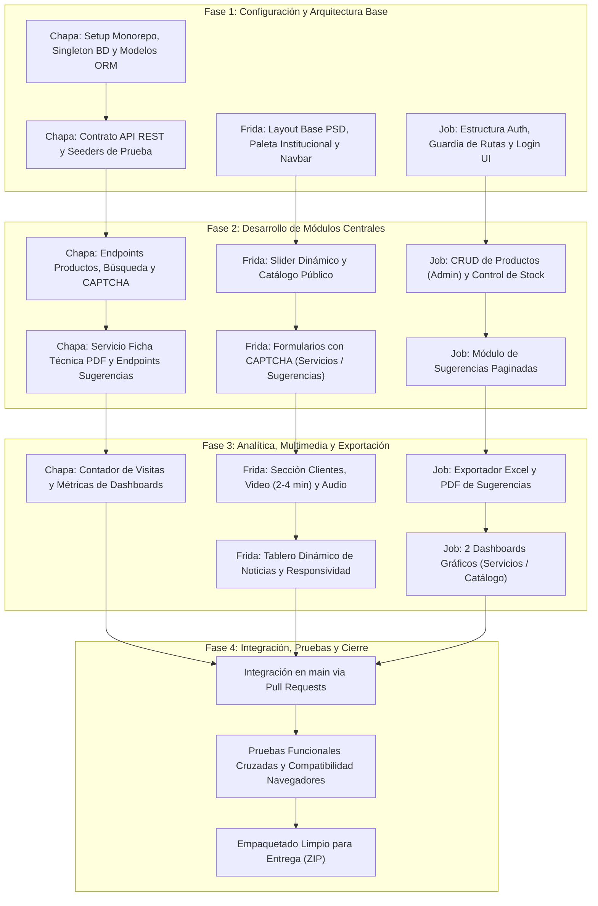

# Plan de Trabajo y Asignación de Roles — Parnet Ingeniería

## 1. Información General del Proyecto
- **Proyecto:** Parnet Ingeniería (Proyecto Integrador / Evaluación Ordinaria)
- **Repositorio:** [https://github.com/Chapinguin/Final-Parnet](https://github.com/Chapinguin/Final-Parnet)
- **Modalidad:** Equipo de 3 desarrolladores con trabajo asíncrono y en paralelo.
- **Integrantes y Ramas de Trabajo:**
  - **Chapa (Sebastian)** — Usuario GitHub: `Chapinguin` | Rama: `chapabranch`
  - **Frida** — Colaboradora GitHub | Rama: `fridabranch`
  - **Job** — Colaborador GitHub | Rama: `jobbranch`
- **Entrega Oficial:** Asignación en Teams (Código fuente en ZIP + Documentación digital de puntos 1 al 7 con Gantt + Video de 2 a 4 min) y presentación/validación presencial.

---

## 2. Requerimientos y Criterios Críticos de Evaluación

### 2.1 Penalizaciones Críticas del Docente
| Concepto | Penalización si falta |
|:---|:---:|
| **Diagrama de Gantt con asignaciones y tiempos por integrante** | **-50 pts** |
| 1. Análisis de requerimientos | -5 pts |
| 2. Diseño y arquitectura | -5 pts |
| 3. Modelo físico de la base de datos | -5 pts |
| 4. Programación estructurada y POO | -5 pts |
| 5. Pruebas de software | -5 pts |
| 6. Implementación y despliegue | -5 pts |
| Uso indebido de PHP | **Prohibido (Anulación)** |

### 2.2 Desglose de Requisitos Funcionales y Técnicos (Rúbrica Específica)
| No. | Requisito del Proyecto | Puntos | Módulo / Responsable |
|:---:|:---|:---:|:---|
| 1 | Sitio web acorde al diseño en Photoshop (`Redes_y_Telecomunicaciones.psd`). | 3 pts | Frontend Público / **Frida** |
| 2 | Slider dinámico en la sección marcada del diseño. | 2 pts | Frontend Público / **Frida** |
| 3 | Estrategia de búsqueda de productos en la sección correspondiente. | 5 pts | Frontend & Backend / **Frida** & **Chapa** |
| 4 | Mantenimiento de datos (CRUD altas, bajas y cambios de productos) exclusivo para Administradores. | 5 pts | Panel Admin / **Job** |
| 5 | Autenticación administrativa (distinción entre zona pública y privada protegida). | 5 pts | Seguridad & Auth / **Job** |
| 6 | Formulario de contacto directo por correo electrónico. | 5 pts | Portal Público / **Frida** |
| 7 | Formulario de sugerencias hacia tabla interna de base de datos con **control CAPTCHA**. | 5 pts | Portal Público & Backend / **Frida** & **Chapa** |
| 8 | Visualización de sugerencias con **paginación** y exportación a **Excel** y **PDF**. | 5 pts | Panel Admin / **Job** |
| 9 | Diseño responsivo adaptable a móviles, tablets y escritorio. | 3 pts | Frontend Global / **Frida** |
| 10 | Imágenes optimizadas por producto ofertado para mejor catálogo visual. | 2 pts | Catálogo & Admin / **Job** & **Frida** |
| 11 | Formulario de solicitud de servicios por áreas y detalle con **control CAPTCHA**. | 5 pts | Portal Público / **Frida** |
| 12 | Sección clientes con logos y enlaces web externos reales. | 3 pts | Portal Público / **Frida** |
| 13 | Integración de Video explicativo (2 a 4 minutos) sobre objetivos, calidad y servicios. | 2 pts | Multimedia / **Frida** & **Job** |
| 14 | Búsqueda y generación de **PDF con ficha técnica** del producto seleccionado. | 5 pts | Backend & Frontend / **Chapa** |
| 15 | Reporte de listado completo de productos con estatus (**Existencia** o **Agotado**). | 5 pts | Panel Admin / **Job** |
| 16 | Tablero de noticias dinámico administrado desde Base de Datos. | 3 pts | Backend & Portal / **Chapa** & **Frida** |
| 17 | Contador de visitas y usuarios conectados en tiempo real/sesión. | 2 pts | Backend & Layout / **Chapa** |
| 18 | **2 Dashboards con gráficos:**<br>1) Análisis de servicios por área solicitada.<br>2) Distribución de productos por categoría/tipo en catálogo. | 5 pts | Panel Admin (BI) / **Job** |
| 19 | Compatibilidad garantizada en navegadores principales (Chrome, Firefox, Edge, Safari). | 5 pts | QA / **Todos** |
| 20 | Modelo físico de base de datos relacional implementado. | 5 pts | Persistencia / **Chapa** |
| 21 | Uso de **ORM** para todas las transacciones de base de datos. | 5 pts | Arquitectura ORM / **Chapa** |
| 22 | Implementación del patrón de diseño **Singleton** (Conexión BD y configuración). | 5 pts | Backend Core / **Chapa** |
| 23 | Implementación de **API REST** documentada y modular. | 5 pts | Backend Core / **Chapa** |
| 24 | Integración multimedia de **Audio** en el portal. | Req. Técnico | Multimedia / **Frida** |
| 25 | Documentación formal completa (Puntos 1 al 7 con Gantt). | 5 pts | Documentación / **Todos** |

---

## 3. Arquitectura y Stack Tecnológico Seleccionado

Basado en el éxito de la arquitectura de *TicketDeTurno*, se replica la estructura desacoplada monorepo que garantiza portabilidad para la entrega en ZIP (sin requerir que el docente instale motores de BD externos pesados) y alta separación de responsabilidades:

- **Backend:** Node.js con Express en arquitectura MVC y Programación Orientada a Objetos (POO).
- **Persistencia / ORM:** Sequelize con SQLite (con opción de configuración MySQL vía `.env`). Portátil, autónomo y cero fricción para pruebas locales.
- **Frontend:** React 18+ con Vite, React Router DOM, Axios / Fetch y diseño CSS estructurado según el mockup Photoshop (`Redes_y_Telecomunicaciones.psd`).
- **Seguridad y Utilidades:**
  - `bcryptjs` para hash de contraseñas de administradores.
  - `jsonwebtoken` (JWT) o cookies seguras para autenticación de rutas privadas.
  - `svg-captcha` para generación de captchas dinámicos en servidor (sin dependencias binarias pesadas).
  - `pdfkit` para la ficha técnica del producto y reportes de sugerencias.
  - `exceljs` o `xlsx` para la exportación de sugerencias a hojas de cálculo.
  - `chart.js` o `recharts` para los 2 dashboards interactivos.
- **Patrón de Diseño Obligatorio:**
  - **Singleton:** Implementado en la clase de conexión a la base de datos `DatabaseConnection.js` y el gestor de configuración global `AppConfig.js`.

---

## 4. Distribución de Responsabilidades por Desarrollador

```
┌──────────────────────────────────────────────────────────────────────────────────┐
│                         PARNET INGENIERÍA (ARQUITECTURA)                         │
├───────────────────────┬──────────────────────────────┬───────────────────────────┤
│    CHAPA (Backend)    │       FRIDA (Frontend)       │     JOB (Admin & BI)      │
│  - Setup Monorepo     │  - Maquetación Mockup PSD    │  - Login Admin & Auth     │
│  - MVC Base + POO     │  - Slider de Inicio          │  - CRUD Productos         │
│  - Conexión Singleton │  - Catálogo Público          │  - Visor Sugerencias Pagin│
│  - Modelos ORM BD     │  - Ficha Técnica PDF (Visor) │  - Exportación Excel/PDF  │
│  - API REST Core      │  - Form Solicitud + CAPTCHA  │  - 2 Dashboards Gráficos  │
│  - Generador PDF Ficha│  - Form Sugerencias + CAPTCHA│  - Reporte Prod/Stock     │
│  - Contador Visitas/Us│  - Form Contacto Email       │  - Admin Tablero Noticias │
│  - Seeders y Mocks    │  - Clientes, Video & Audio   │  - Pruebas Admin          │
└───────────────────────┴──────────────────────────────┴───────────────────────────┘
```

### 👤 1. Sebastian Chapa (`chapabranch`) — Backend Core, ORM, API REST & Servicios
**Objetivo:** Proveer los cimientos para que Frida y Job puedan consumir datos reales o mockeados sin dependencias bloqueantes.
- **Entregables específicos:**
  1. Estructura base del proyecto (`backend/`, `frontend/`, `docs/`, `scripts/`).
  2. Implementación de **Singleton** para la conexión ORM (`Database.js`).
  3. Definición de modelos Sequelize con POO:
     - `Usuario` (id, username, password, email, rol).
     - `Producto` (id, codigo, nombre, descripcion, especificaciones, categoria, imagen_url, precio, estatus [Existencia/Agotado]).
     - `ServicioSolicitud` (id, cliente_nombre, email, telefono, empresa, area, detalle, estatus, fecha).
     - `Sugerencia` (id, nombre, email, mensaje, fecha).
     - `Noticia` (id, titulo, contenido, fecha, imagen_url, activo).
     - `Estadistica` (visitas, conexiones activas).
  4. Rutas y Controladores de la API REST:
     - `/api/auth` (login, verify, logout).
     - `/api/productos` (listado público con filtros/búsqueda, detalle, y generación de PDF técnico).
     - `/api/servicios` (registro de solicitud con validación CAPTCHA).
     - `/api/sugerencias` (registro público con CAPTCHA; lectura paginada admin).
     - `/api/noticias` (lectura pública y CRUD admin).
     - `/api/analytics` (contador de visitas y datos agregados para los 2 dashboards).
     - `/api/captcha` (generación de reto gráfico con texto temporal en sesión/token).
  5. Servicio `PdfGeneratorService` con POO para la **Ficha Técnica de Producto**.
  6. Script de carga inicial (`seeders.js`) con productos, noticias, usuarios y datos representativos para pruebas inmediatas.

### 👤 2. Frida (`fridabranch`) — Portal Público, Mockup PSD, Multimedia y Formularios
**Objetivo:** Construir la experiencia pública interactiva idéntica al diseño en Photoshop con alta calidad estética y responsividad.
- **Entregables específicos:**
  1. Layout global con Navbar y Footer institucional acorde a la paleta de colores del PSD.
  2. **Slider animado** en la cabecera (banner de telecomunicaciones, fibra óptica, voz y datos).
  3. **Catálogo Público de Productos:**
     - Barra de búsqueda reactiva por nombre, código o categoría.
     - Tarjetas con imágenes de producto, estatus y botón "Descargar Ficha Técnica PDF".
  4. **Formulario de Solicitud de Servicios:**
     - Selección de áreas (Redes, Cableado Estructurado, Fibra Óptica, Telefonía IP).
     - Detalle del requerimiento y componente de **control CAPTCHA** con recarga dinámica.
  5. **Formulario de Sugerencias:**
     - Envío directo a la base de datos interna con validación de CAPTCHA y confirmación visual.
  6. **Formulario de Contacto:**
     - Campos de correo electrónico, teléfono y mensaje con retroalimentación instantánea.
  7. **Sección Clientes:**
     - Malla de logotipos empresariales con hipervínculos externos funcionales.
  8. **Módulo Multimedia:**
     - Integración y reproducción de Video institucional (2 a 4 minutos).
     - Integración de reproductor de Audio informativo/ambiental.
  9. Tablero de noticias dinámicas (tarjetas renderizadas desde `/api/noticias`).
  10. Contador de visitas y usuarios en el footer o barra de estado.

### 👤 3. Job (`jobbranch`) — Panel Administrativo, Seguridad, CRUDs y Dashboards (BI)
**Objetivo:** Implementar la zona privada segura, mantenimiento de catálogos y analítica de datos visual.
- **Entregables específicos:**
  1. **Módulo de Autenticación Administrativa:**
     - Pantalla de Login privada con control de sesión seguro y protección de rutas con guardia (`PrivateRoute`).
     - Botón de cierre de sesión seguro.
  2. **CRUD Completo de Productos:**
     - Tabla administrativa con acciones: Crear nuevo producto, Editar información, Eliminar y Cambiar estatus (*Existencia* / *Agotado*).
     - Carga/asociación de imágenes para el catálogo.
  3. **Visor de Sugerencias:**
     - Tabla con **paginación** interactiva (ej. 10 elementos por página).
     - Botón de **exportación a Excel** (`.xlsx`).
     - Botón de **exportación a PDF** estructurado.
  4. **Reporte General de Productos:**
     - Vista imprimible o descargable con el total de inventario y desglose de estatus.
  5. **2 Dashboards con Gráficos Interactivos (Chart.js):**
     - **Gráfico 1:** Distribución de solicitudes de servicio por área tecnológica.
     - **Gráfico 2:** Catálogo de productos ofertados agrupados por categoría o estatus.
  6. **Administración de Noticias:**
     - Formulario sencillo para publicar nuevas noticias en el tablero público.

---

## 5. Flujo de Trabajo y Cronograma de Ejecución (Sin Timestamps)

> [!NOTE]
> Siguiendo el acuerdo del equipo, el flujo de trabajo se organiza por **fases y etapas secuenciales de avance funcional** (sin fechas calendario ni marcas de tiempo rígidas), permitiendo trabajo asíncrono y desacoplado entre los tres desarrolladores.



### Matriz de Flujo de Trabajo por Fases

| Fase | Sebastian Chapa (`chapabranch`) | Frida (`fridabranch`) | Job (`jobbranch`) |
|:---|:---|:---|:---|
| **Fase 1: Cimientos y Arquitectura** | • Inicialización de monorepo (`backend/`, `frontend/`, `docs/`).<br>• Conexión Singleton SQLite/Sequelize (`Database.js`).<br>• Modelos ORM y Seeders con datos iniciales.<br>• Contrato de API REST (`docs/CONTRATO_API.md`). | • Maquetación inicial React Vite con CSS acorde al PSD.<br>• Estructura de navegación y componentes compartidos.<br>• Implementación del componente Slider de cabecera. | • Arquitectura de autenticación administrativa.<br>• Componente Login con CAPTCHA.<br>• Definición de rutas privadas protegidas (`/admin/*`). |
| **Fase 2: Módulos Operacionales** | • Endpoints REST de Productos, Búsqueda y Filtros.<br>• Servicio generador de la Ficha Técnica en PDF.<br>• Endpoints de Sugerencias y Solicitud de Servicios.<br>• Endpoint de generación y validación de CAPTCHA. | • Vista de Búsqueda de Productos con descarga de PDF técnico.<br>• Formulario de Solicitud de Servicios por área con CAPTCHA.<br>• Formulario de Sugerencias internas con CAPTCHA.<br>• Formulario de Contacto por correo. | • Tabla administrativa CRUD de Productos (altas, bajas, cambios, estatus).<br>• Pantalla de Sugerencias con paginación.<br>• Mantenimiento del catálogo de imágenes. |
| **Fase 3: Analítica, Multimedia y Reportes** | • Contador de visitas y usuarios activos concurrentes.<br>• Endpoint de métricas agregadas para los 2 Dashboards.<br>• Soporte y ajustes de API para frontend. | • Integración de Video explicativo (2-4 min) y Audio ambiental.<br>• Sección Clientes con enlaces web reales.<br>• Render dinámico de Tablero de Noticias.<br>• Ajustes de diseño responsivo. | • Módulo de exportación a Excel (`.xlsx`) y PDF para sugerencias.<br>• Construcción de Dashboard 1 (Servicios por Área con gráficos).<br>• Construcción de Dashboard 2 (Catálogo de Productos con gráficos).<br>• Reporte general de productos (Existencia/Agotado). |
| **Fase 4: Integración y Entrega** | • Revisión y merge de PRs de `fridabranch` y `jobbranch` a `main`.<br>• Pruebas de endpoints automatizadas.<br>• Script de empaquetado `scripts/empaquetar.sh`. | • Verificación visual cross-browser (Chrome, Firefox, Edge).<br>• Pruebas de formularios y validaciones de usuario. | • Verificación de flujos administrativos completos.<br>• Generación de reportes de prueba. |

---

## 6. Primeras Tareas Inmediatas para Chapa (`chapabranch`)

Para desbloquear a Frida y Job de inmediato, Sebastian ejecuta los siguientes pasos:

1. **Configurar la estructura del repositorio:**
   ```
   Final-Parnet/
   ├── backend/
   │   ├── src/
   │   │   ├── config/ (Database Singleton)
   │   │   ├── models/
   │   │   ├── controllers/
   │   │   ├── routes/
   │   │   ├── services/
   │   │   └── server.js
   │   ├── package.json
   │   └── .env.example
   ├── frontend/
   │   ├── src/
   │   │   ├── components/
   │   │   ├── pages/
   │   │   ├── services/
   │   │   └── App.jsx
   │   ├── package.json
   │   └── vite.config.js
   ├── docs/
   │   ├── CONTRATO_API.md
   │   └── mockup/
   └── PLAN_DE_TRABAJO.md
   ```
2. **Crear `docs/CONTRATO_API.md`:** Especificar los endpoints, métodos HTTP, parámetros y respuestas JSON estándar para que Frida y Job puedan mockear o enlazar sus vistas.
3. **Subir los cambios a `main` y crear las ramas:**
   - Crear y pushear `chapabranch`, `fridabranch` y `jobbranch`.
   - Notificar a Frida y Job para que clonen el repo, hagan checkout de su respectiva rama y comiencen sus módulos.

---

## 7. Políticas de Git y Trabajo Asíncrono
1. **Ramas Personales Aisladas:** Cada integrante realiza commits únicamente en su rama (`chapabranch`, `fridabranch`, `jobbranch`).
2. **Sincronización:** Antes de iniciar la jornada, cada dev debe hacer `git pull origin main` para tener los últimos cambios integrados.
3. **Integración mediante Pull Requests:** Las funciones completadas se integran a `main` mediante PR verificado para evitar conflictos de fusión.
4. **Protección de Secretos:** El archivo `.env` está estrictamente ignorado en `.gitignore`. Se provee `.env.example` con valores predeterminados seguros.
5. **Idioma y Estilo de Commits:** Mensajes claros en español siguiendo formato convencional (ej. `feat(backend): agregar modelo de producto y conexion singleton`, `feat(frontend): maquetar slider de inicio`).

